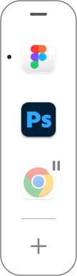
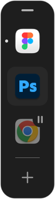

# Rail — work in progress

A tiny vertical strip for the Mac apps you’re working between.

**Early preview · v0.1.1 · Native AppKit · macOS 14+**

Rail keeps a small set of app icons within reach. Click to switch, right-click for options, and put an app aside without quitting it.

<p> &nbsp;&nbsp; </p>

These are rendered previews of the native controls. The icon set is illustrative.

## What works

- Add installed or running apps to the strip.
- Switch between them with a click.
- Hide an app and bring it back; it keeps running.
- Reorder and remove icons from the context menu.
- Remember the working set and rail position locally.
- Enter keyboard mode from the menu bar menu, navigate with arrows, open options and switch apps.

The strip stays 54 points wide, with 30-point icons. Secondary controls live in menus. Long lists have a scrolling viewport rather than a larger permanent interface.

## WIP status

The current build compiles and passes 23 focused checks. Live checks covered switching to Figma, Photoshop and Chrome; app hiding/restoration; saved pins across restart; keyboard entry, arrow navigation, native focus feedback, Control-Return options, Return switching and Escape return.

Individual-window selection and parking are implemented through macOS Accessibility APIs but **still need live validation**. VoiceOver, long-list scrolling, multi-display and full-screen behavior also need further testing. Window matching currently depends on a unique title, so renamed documents may need to be selected again.

Parking means **hiding an app or minimizing a chosen window**. It does not suspend processes or promise CPU/RAM savings.

This is a development preview, not a notarized end-user release. Builds are signed locally; distribution signing and notarization are still to do. No license has been selected for this repository yet.

## Build locally

Use a Mac with Swift 6 or newer (Xcode or Apple's command-line tools):

```sh
git clone https://github.com/leolunelove/Rail.git
cd Rail
zsh scripts/build.sh
open dist/Rail.app
```

The app appears as a floating strip and a menu bar icon, without a Dock slot. The development build is for the Mac architecture you compile on; the current local preview was tested on Apple silicon.

## Use

- Click an icon to switch or launch the app.
- Drag the top grip to move the strip.
- Use **+** to add an app. Right-click an icon to reorder it or open its options.
- **Hide app (all windows)** puts the app aside. Click its icon to bring it back.
- **Switch to → Whole app** is always available as a recovery path.
- To try individual windows, enable Rail in **System Settings → Privacy & Security → Accessibility**, then use **Switch to** in an icon’s menu. This part is experimental.
- From the menu bar menu, choose **Focus Rail with keyboard**. Use arrows/Tab, Return/Space, Control-Return or Shift-F10 for options, and Escape to return to the previous app.
- Use the menu bar icon to hide/show Rail, reset its position or quit.

Quitting Rail leaves the other apps open. Settings stay on your Mac in `~/Library/Application Support/Rail/settings.json`. Rail has no account, analytics or network service.

## Checks and next steps

```sh
dist/Rail.app/Contents/MacOS/Rail --self-test
```

The automated checks cover persistence, geometry, screen recovery calculations, title matching and state transitions. They do not substitute for live macOS integration tests.

- [Validation status and roadmap](docs/STATUS.md)
- [Hands-on usability test](docs/USABILITY-TEST.md)
- [Design constraints](DESIGN.md)

For a useful issue report, include the macOS version, app, action, permission state and observed result. Please omit sensitive window titles or document contents.
